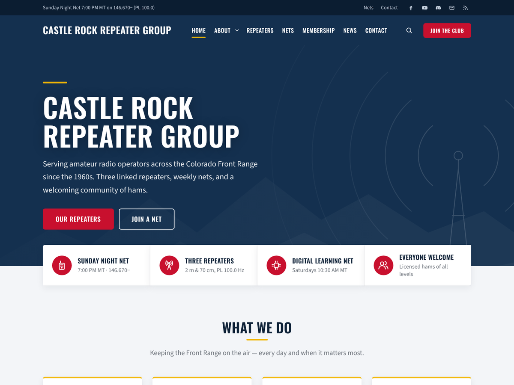

# CRRG WordPress Theme

A configurable WordPress theme for the [Castle Rock Repeater Group](https://crrg.club) amateur radio club. It is a classic PHP theme, so every option lives in **Appearance → Customize** and works with the block editor, classic widgets and page builders.



## Installation

1. Download this repository as a ZIP (**Code → Download ZIP**). Development files are left out of the ZIP by `.gitattributes`.
2. In WordPress go to **Appearance → Themes → Add New Theme → Upload Theme**, choose the ZIP and click **Install Now**, then **Activate**.
3. Open **Appearance → Customize**. On a fresh site the Customizer offers starter content: Home, About, Repeaters, Nets, Membership, Contact and News pages, plus menus and widgets.

Requires WordPress 6.3+ and PHP 7.4+.

## Where everything is

### Customizer → CRRG Theme Options

| Section | Options |
| --- | --- |
| **Typography** | Font source (Google Fonts or system fonts only), body font, heading/menu font (16 choices), base size, heading weight, uppercase headings, uppercase menus and buttons |
| **Top Bar** | Show/hide, text (basic HTML, e.g. net times), Top Bar menu, social icons |
| **Header** | Layout: *logo left / menu right*, *logo centred / menu below*, *logo + header widget area / menu bar below*. Sticky header, transparent header over the front-page hero, search button, social icons, mobile menu style (slide-in or drop-down), **mobile menu breakpoint**, header button text/link/new tab |
| **Layout & Sidebars** | Wide or boxed site, content width, sidebar width, default layout for the blog, archives, search, single posts and pages, sticky sidebars, card style (shadow / bordered / flat), corner radius |
| **Page Title Banner** | Show/hide, height, alignment, default background image, featured image as background, breadcrumbs (uses Yoast, Rank Math or SEOPress when active) |
| **Blog & Archives** | List / classic / grid style, grid columns, excerpt length, "Read more" text, featured images, date/author/categories/comment-count toggles, numbered or older/newer pagination |
| **Single Posts** | Featured image, meta, tags, author box, previous/next links, related posts and how many |
| **Footer** | 0–4 widget columns, equal or wide-first columns, copyright text with `{year}` and `{site}`, footer menu, social icons, "Powered by WordPress" credit, back-to-top button |
| **Social Links** | Facebook, X, YouTube, Instagram, Discord, GitHub, LinkedIn, Mastodon, Reddit, Groups.io, email, RSS, open in new tab |

### Customizer → Front Page Sections

Hero (heading, text, background image, height, alignment, two buttons) · Info bar (four facts with icons) · Feature cards (heading, intro, 2–4 columns, four cards with icon/title/text/link) · Page content · Latest posts (title, count, category) · Call to action band · **Section Order** (drag and drop, including the Front Page Top/Bottom widget areas).

### Customizer → Colors

Pick a preset (**Colorado Navy**, Signal Orange, Tactical Olive, Front Range Forest, Clean Light) to fill every colour at once, then fine-tune 18 individual colours: primary, secondary, accent, page and card backgrounds, text, headings, links, top bar, header, footer and hero overlay (with opacity). Text on brand colours switches between black and white automatically for contrast. The block editor colour palette follows these colours.

### Site Identity

Logo, logo maximum height, show/hide title and tagline, and an optional **call sign** badge beside the title.

## Layouts

Five content layouts: **right sidebar**, **left sidebar**, **both sidebars**, **no sidebar** (centred, readable width) and **full width** (edge to edge for wide and full blocks).

The layout used for a page is decided in this order:

1. **Page template** (Page Attributes → Template): Right Sidebar, Left Sidebar, Both Sidebars, No Sidebar, Full Width, or **Landing Page** (logo, optional Landing menu, no top bar, title, sidebars or footer widgets).
2. The **CRRG Layout** box in the editor: layout, which sidebar to show, hide title, hide title banner.
3. The Customizer default for that content type.

A sidebar with no widgets is never shown as an empty column. The layout falls back automatically.

## Widget areas (14)

Primary Sidebar · Page Sidebar (falls back to Primary) · Secondary Sidebar (left side of the dual layout) · Custom Sidebar 1 & 2 (choose per post/page) · Header (stacked header layout) · Front Page Top · Front Page Bottom · Before Content · After Content · Footer 1–4.

## Menu locations (5)

Primary · Top Bar · Mobile (falls back to Primary) · Footer · Landing Page. Dropdowns support any depth and have keyboard and touch toggles. The mobile panel keeps keyboard focus inside it while open.

## Club widgets

- **CRRG: Repeaters**: one repeater per line, `Name | Output | Offset | Tone`.
- **CRRG: Net Schedule**: one net per line, `Day & time | Net | Frequency or talkgroup`.
- **CRRG: Contact Info**: call sign, email (spam-protected), phone, address, meetings.
- **CRRG: Call to Action**: heading, text and button in primary, secondary or accent colour.
- **CRRG: Social Icons**: the links from the Social Links section.
- **CRRG: Recent Posts**: with thumbnails, dates and a category filter.

## Block patterns and styles

Patterns (inserter → **CRRG**): Repeater table, Net schedule, Three feature cards, Call to action band, Membership options, FAQ, Contact and meeting info.

Block styles: *Card* (Group), *Frequency table* (Table), *Checklist* (List), *Accent underline* (Heading).

The repeater and net details in the patterns, widgets and starter content come from the club's public listings. Check them against the current crrg.club pages before publishing.

## Development

```
assets/        CSS, JS and images
inc/           Theme logic (Customizer, layout, widgets, template tags)
page-templates Layout templates
patterns/      Block patterns (registered automatically)
template-parts Header, footer, front page and post partials
```

Run PHP_CodeSniffer with the WordPress standard using the included `phpcs.xml.dist`:

```
composer global require wp-coding-standards/wpcs
phpcs
```

Developers can use the filters `crrg_option_defaults`, `crrg_color_presets`, `crrg_fonts`, `crrg_icon_library`, `crrg_layout`, `crrg_requested_layout`, `crrg_main_sidebar`, `crrg_show_page_banner`, `crrg_page_title`, `crrg_entry_meta`, `crrg_social_links`, `crrg_breadcrumb_trail` and `crrg_starter_content`.

## License

GPL-2.0-or-later. See [LICENSE](LICENSE).
